# Northstar example gallery

The images below are **rendered documentation previews**, generated from the repository's fictional Northstar dataset and case/change registers. They are illustrative interface views, not browser screenshots of Google Sheets, a live monitoring run, or an organization-only deployment. All comments, owners, decisions, and events are invented.

Use the [connected walkthrough](../examples/closed-loop/walkthrough.md) to trace the same records through all four parts and the bonus. Actual assistant-generated workbooks and apps will vary with the company's sources, current Sheet, and supported tools.

## Benchmark

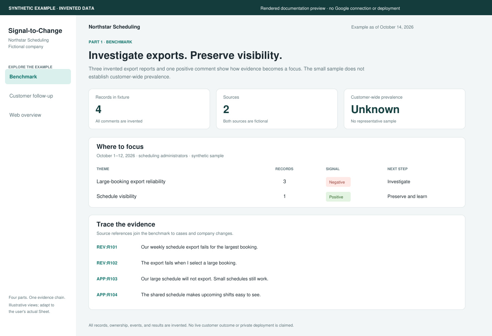

**What to look for:** three export reports support investigation, while one positive visibility comment suggests something to preserve. The view shows its sample size and says customer-wide prevalence is unknown. Source/record pairs remain available for tracing into follow-up.

**Data:** [Review_Data.csv](../examples/closed-loop/benchmark/Review_Data.csv), [Source_Register.csv](../examples/closed-loop/benchmark/Source_Register.csv), and [Signal_to_Focus.csv](../examples/closed-loop/benchmark/Signal_to_Focus.csv).

## Customer follow-up

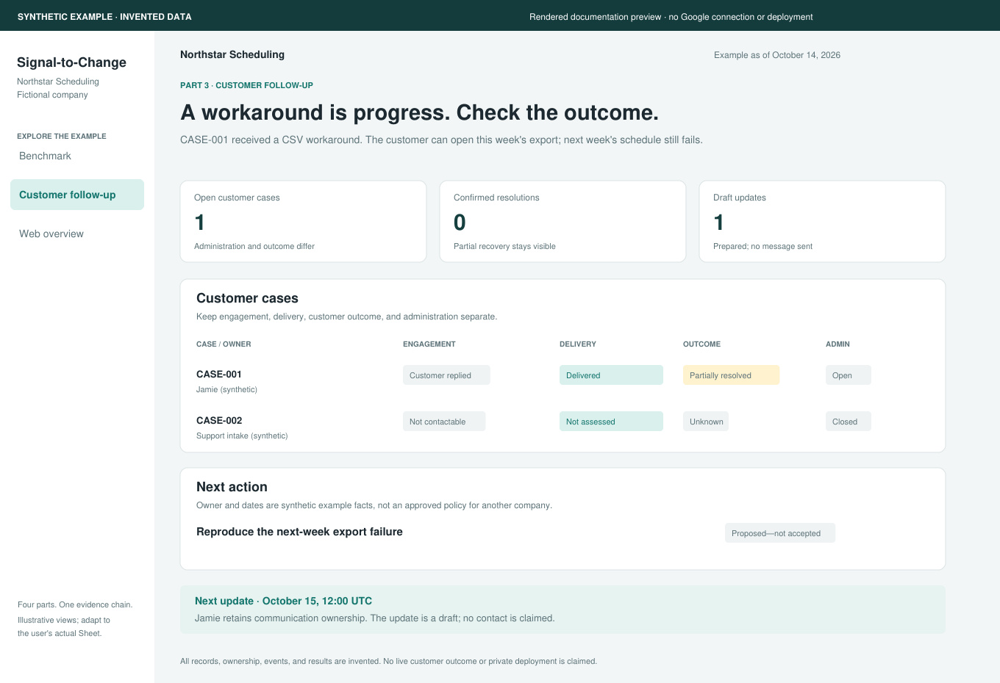

**What to look for:** CASE-001 has a delivered workaround and a partially resolved customer outcome, so it remains open. CASE-002 has no legitimate contact route and is administratively closed, while its outcome stays unknown. A draft update is not counted as sent.

**Data:** [Follow_Up_Cases.csv](../examples/closed-loop/registers/Follow_Up_Cases.csv), [Case_Actions.csv](../examples/closed-loop/registers/Case_Actions.csv), and [Customer_Updates.csv](../examples/closed-loop/registers/Customer_Updates.csv).

## Web overview

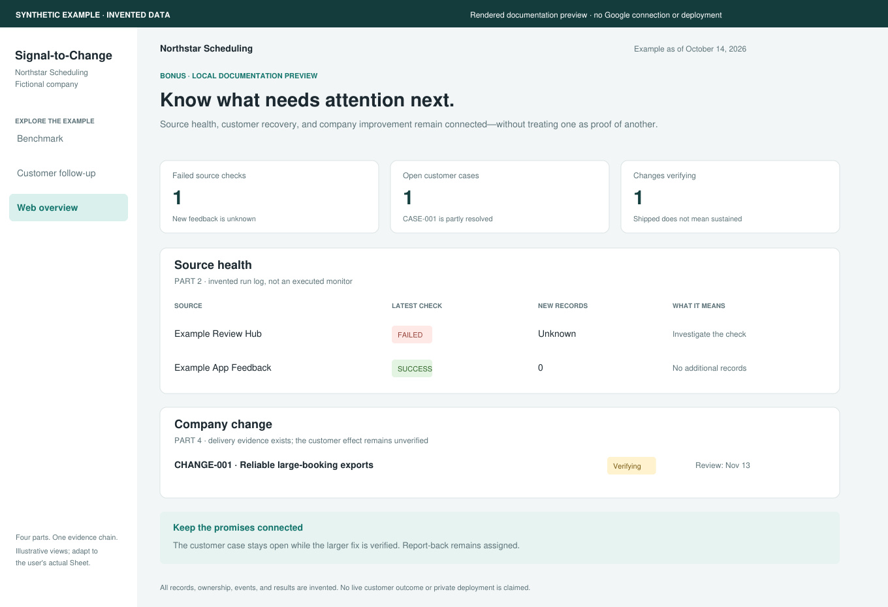

**What to look for:** a failed source check produces unknown new-feedback volume, rather than zero. The customer case remains partly resolved. The company change has delivery evidence and is still verifying its effect.

**Data:** [Monitor_Run_Log.csv](../examples/closed-loop/monitoring/Monitor_Run_Log.csv), [Change_Register.csv](../examples/closed-loop/registers/Change_Register.csv), and [Change_Case_Links.csv](../examples/closed-loop/registers/Change_Case_Links.csv).

## Eight-screen web reference

These refreshed dark-theme views use the supplied page layout as visual direction, with all company details, email addresses, deployment links, review text and private activity replaced by the repository's existing synthetic Northstar data. They are newly rendered documentation, not redacted evidence of a live run. The five edit actions remain in the [reference files](../skills/voc-sheet-web-app/references/workbook-setup-and-team-use.md); buttons in this static gallery cannot save or send anything.

Download [the eight-screen HTML preview](images/northstar-web-reference.html) and open it locally to navigate all eight screens. It makes no network calls and contains no credentials or real operational records.

### Home

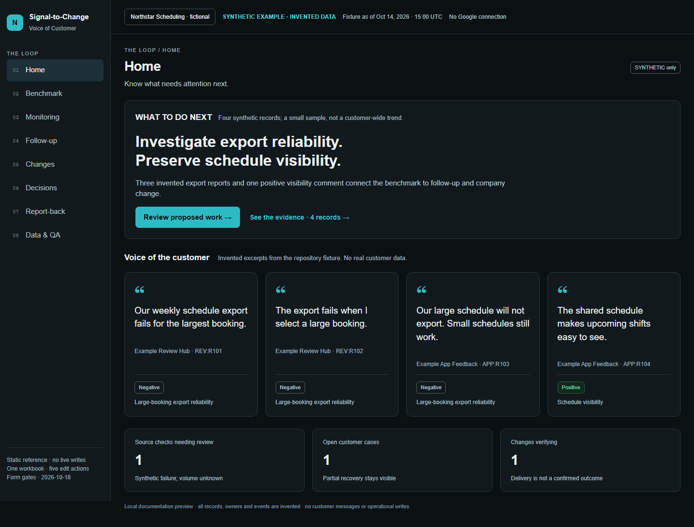

### Benchmark

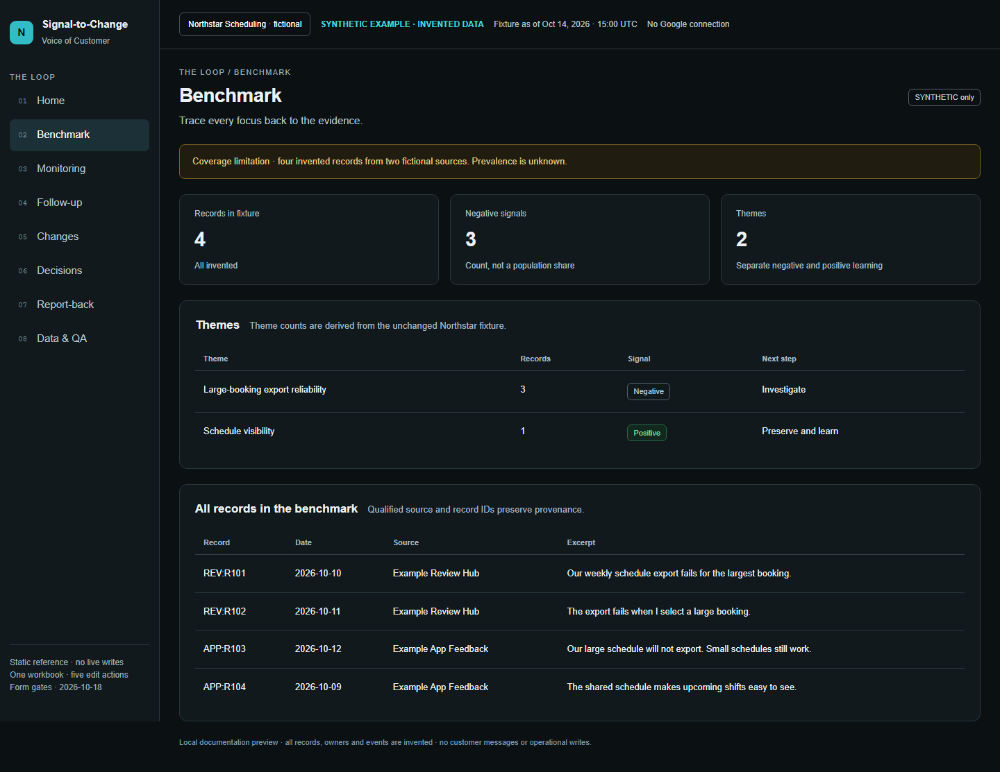

### Monitoring

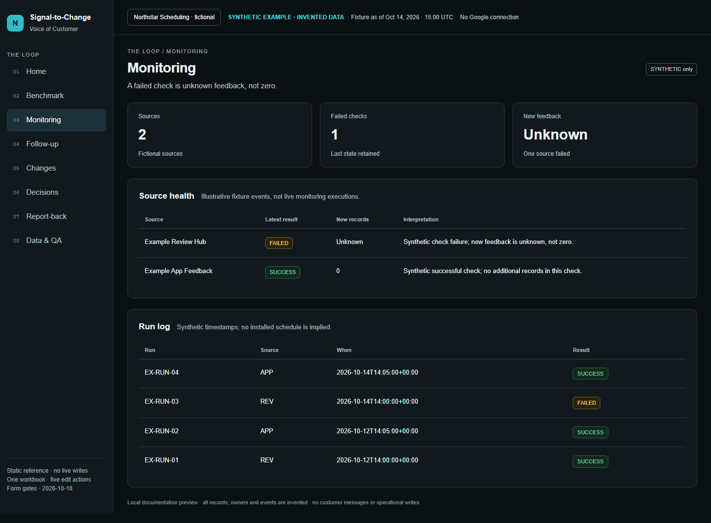

### Follow-up

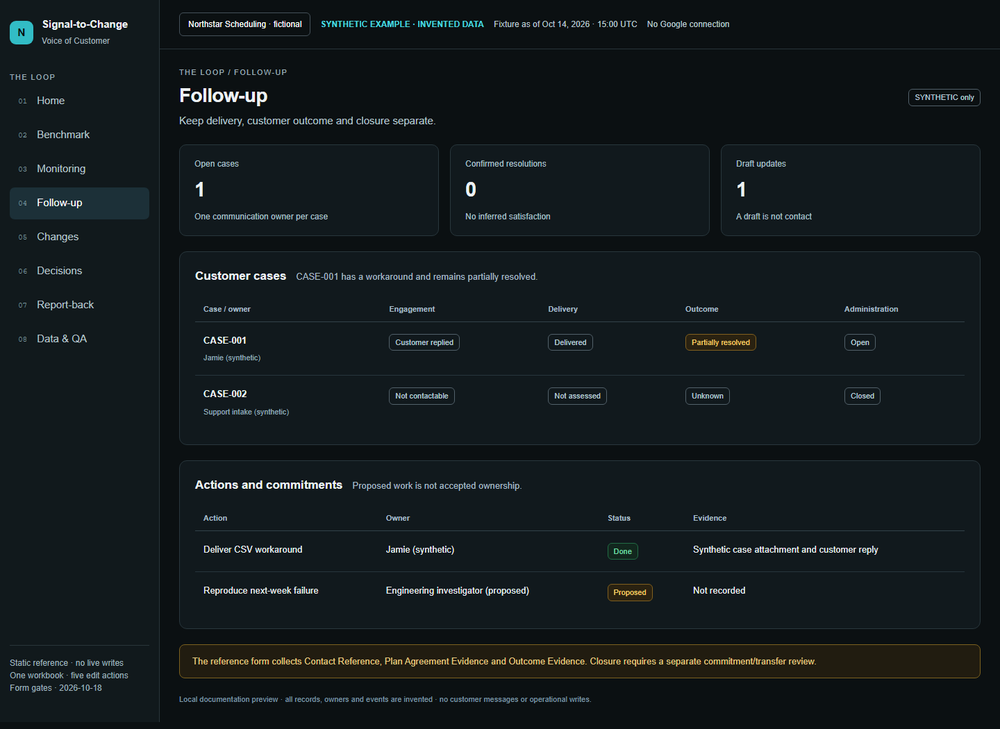

### Changes

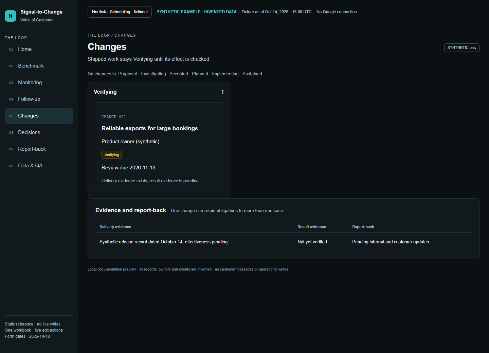

### Decisions

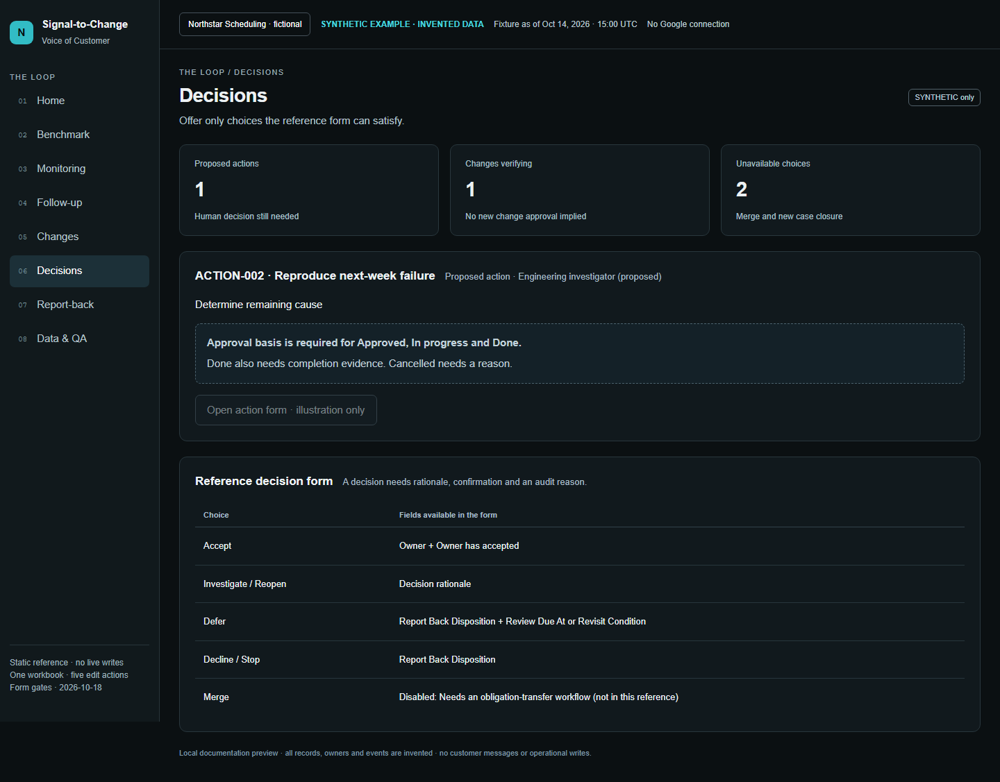

### Report-back

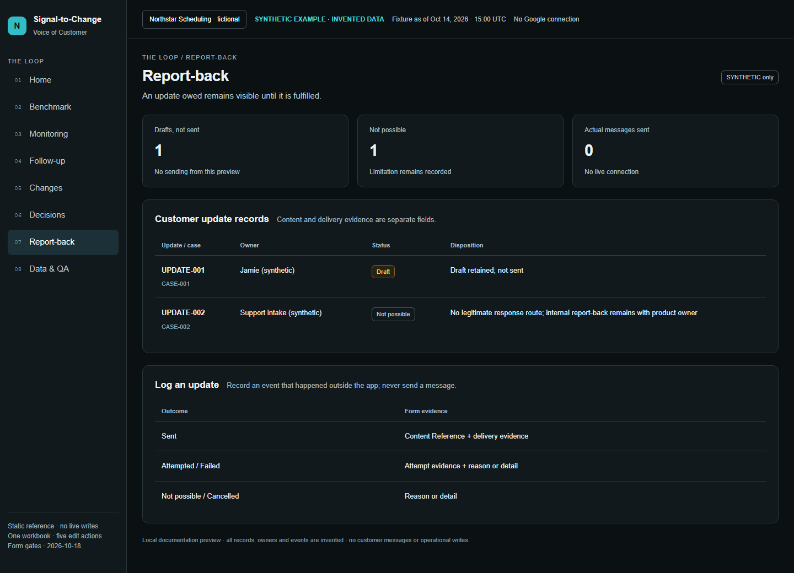

### Data and QA

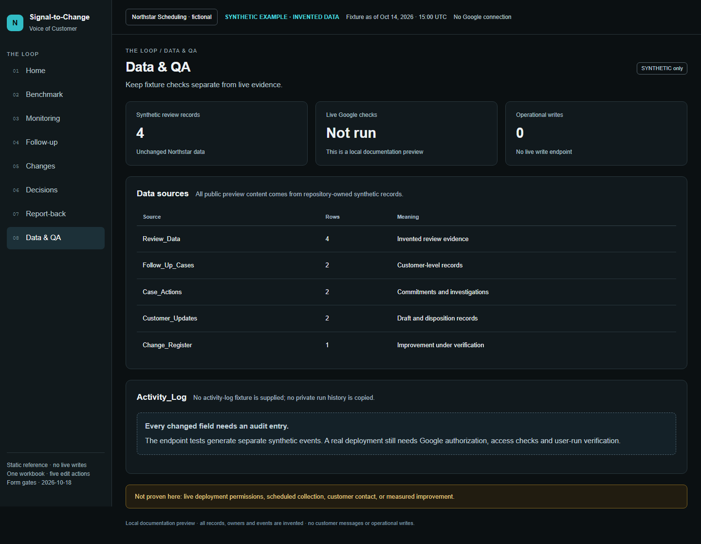

## Explore and reproduce

Download [preview.html](../examples/closed-loop/preview.html) and open the downloaded file in a local browser to switch between the original three views. GitHub's file view shows source code rather than running the HTML. The local preview needs no connection, makes no network calls, sends no messages, and makes no operational writes.

The SVG/JPEG images are rendered separately from the same synthetic inputs. They communicate the same example states but are not pixel captures of that HTML. Source SVGs are beside the JPEGs for accessible inspection and editing.

To rebuild the CSVs/local preview from the fixture and existing registers:

```bash
python scripts/build_example.py
```

To regenerate the three images in an environment with PyMuPDF already available:

```bash
python scripts/render_example_previews.py
```

Run the checks in [validation.md](validation.md) afterward. Replace these illustrative images with sanitized real-run captures only when the relevant output and its live-test status have actually been verified.

To regenerate the eight-screen HTML and PNG gallery (Playwright plus its Chromium browser are optional rendering dependencies):

```bash
python scripts/build_web_reference_preview.py
node scripts/render_web_reference_previews.cjs
```

The renderer supports `CHROMIUM_EXECUTABLE_PATH` for an already installed compatible Chromium. It blocks network requests, captures at 1440 px, and checks all eight pages for page overflow at 390 px. The synthetic example JSON and CSVs remain unchanged.
